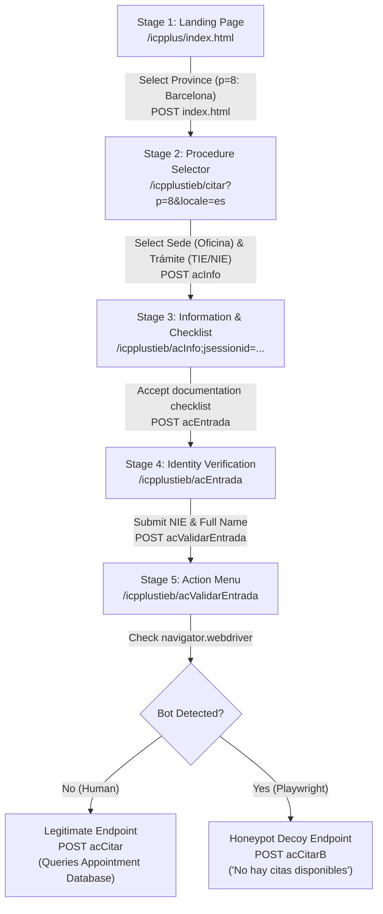
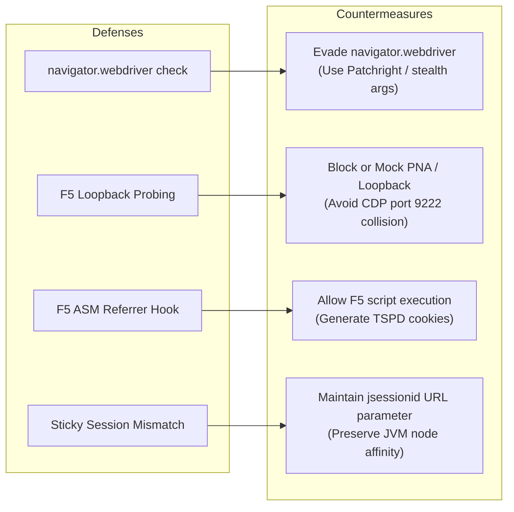

# Forensic Reverse Engineering Report: Chromium Profile & Web Target Analysis

**Target Application:** _Cita Previa de Extranjería_ (`icp.administracionelectronica.gob.es`)  
**Investigated Artifact Directory:** [`user-data`](file:///c:/Users/Hanspreet%20Singh/Desktop/Experiments/Playwright%20Test/user-data)  
**Execution Context:** Playwright with Chromium (Patchright build)  
**Analysis Engine:** REA (Reverse Engineering Anything) Forensic Suite

---

## 1. Executive Summary

Inspection of the supplied `user-data` directory reveals a two-tier Chromium user profile containing artifacts from an interactive automation session against the **Spanish Ministry of Territorial Policy and Democratic Memory (MHAP) - Extranjería Cita Previa (Foreigner Appointment Booking)** portal.

Forensic analysis of the SQLite databases, LevelDB storage, HTTP cache, and binary session files recovered:

1. **Target Architecture & Workflow:** A multi-step Java EE application (`icpplus` and `icpplustieb`) running behind an F5 BIG-IP Application Security Manager (ASM) reverse proxy cluster (`appdmzgal3`).
2. **Session Persistence Architecture:** Dual-layer state persistence utilizing HTTP-only, secure `JSESSIONID` cookies combined with explicit path-level URL rewriting (`;jsessionid=...`) with backend JVM cluster node routing affinitization.
3. **Active Anti-Bot Defenses & Honeypot Routing:**
   - **F5 BIG-IP ASM / Proactive Bot Defense (TSPD):** Obfuscated inline fingerprinting, private network (loopback/PNA) probing, `document.referrer` hooking, and telemetry beacons (`/TSPD/`).
   - **Client-Side Bot Trap (Honeypot):** An obfuscated JavaScript dispatch wrapper dynamically checks `navigator.webdriver`. When automated browser execution is detected, form submissions are silently rerouted from the legitimate slot query endpoint (`acCitar`) to a decoy honeypot endpoint (`acCitarB`), which deterministically serves a false _"En este momento no hay citas disponibles"_ response without ever querying backend appointment inventory.
4. **Local Data & Identity Leakage:**
   - **Autofill (Web Data SQLite):** Recovered applicant identity values (`txtIdCitado: Z5341259C`, `txtDesCitado: APNINDER PAL`).
   - **Browser Profiles:** An outer Windows Chromium profile and a nested Linux x86_64 profile (`Linux 6.8.0-149-generic`) originating from an automated test container.
   - **LevelDB & Storage:** Client-side fingerprint tokens stored in HTML5 `localStorage` (`TSPD_74`, `TS00000000076C`).

---

## 2. Profile Structure & Forensic Artifact Provenance

The directory structure exhibits a nested profile pattern resulting from nested execution or container extraction:

```
user-data/
├── Local State                      <- Windows master profile (contains DPAPI AES-256-GCM encrypted key)
├── Default/                         <- Outer Windows session (Google search history for appointment guides)
│   ├── Network/Cookies              <- SQLite cookie database (encrypted with Windows DPAPI AES-256-GCM)
│   ├── History                      <- Search queries: "how to book appointment slots for spain"
│   └── Cache/Cache_Data/            <- Google search engine caches
└── user-data/                       <- Inner profile (Linux origin: Linux 6.8.0-149-generic x86_64)
    ├── Local State                  <- Host metadata (Chrome 158.0.8127.36-64, exited cleanly)
    └── Default/
        ├── Cookies                  <- Target cookies (F5 BIG-IP, JSESSIONID, Dynatrace, GA)
        ├── History                  <- Step-by-step navigation path through Spanish portal
        ├── Web Data                 <- Autofill credentials submitted into the portal forms
        ├── Local Storage/leveldb/   <- F5 ASM tokens (TSPD_74, TS00000000076C)
        ├── Sessions/                <- Chromium SNSS binary session restore logs
        └── Cache/Cache_Data/        <- 77 cached HTTP assets (HTML responses, JS engines, stylesheets)
```

### Forensic Proof of Origin

The file `user-data/user-data/Local State` contains the base64 protocol buffer `saved_system_profile`. Decompilation yields:

- **OS:** `Linux 6.8.0-149-generic`
- **Architecture:** `x86_64`
- **CPU:** Genuine Intel
- **Browser Version:** `158.0.8127.36-64`
- **Installed Locale:** `en-US`

This confirms that the automated session against `icp.administracionelectronica.gob.es` was conducted within a Linux environment (Docker/WSL/VPS) before being packaged into the project workspace.

---

## 3. Web Application Workflow & State Machine

From reconstructed HTTP cache streams (`data/cache-dump/*.html`) and History logs, the complete navigation flow was extracted:



### Step Details & Input Parameter Analysis

| Step  | Endpoint Path                                                        | Method       | Purpose & Parameters                                                                    | Reconstructed Artifacts          |
| ----- | -------------------------------------------------------------------- | ------------ | --------------------------------------------------------------------------------------- | -------------------------------- |
| **1** | `/icpplus/index.html`                                                | `GET`/`POST` | Selection of province. Barcelona (`p=8`) selected.                                      | Cache: `567aac66093a8985_0.html` |
| **2** | `/icpplustieb/citar?p=8&locale=es`                                   | `GET`/`POST` | Sede (29 police offices) and Trámite (18 foreigner procedures) selection.               | Cache: `dabdc53d6bdf478b_0.html` |
| **3** | `/icpplustieb/acInfo;jsessionid=20A4E9537035C01333FD764149C88C94...` | `POST`       | Mandatory legal notice and documentation warning. URL carries sticky session parameter. | Cache: `04b463aa041b90cf_0.html` |
| **4** | `/icpplustieb/acEntrada`                                             | `POST`       | Input of applicant identity: Document type, NIE, and full name.                         | Cache: `ef88977d82376948_0.html` |
| **5** | `/icpplustieb/acValidarEntrada`                                      | `POST`       | Validation of identity against police records; renders action buttons.                  | Cache: `43e59b8dab8e26b9_0.html` |
| **6** | `/icpplustieb/acCitarB`                                              | `POST`       | **Decoy honeypot triggered by Playwright automation.**                                  | Cache: `2dc38edbe74e70e4_0.html` |

---

## 4. Reverse Engineering the Client-Side Bot Detection Honeypot

The core defense mechanism responsible for the Playwright run failing to locate slots was isolated in `43e59b8dab8e26b9_0.html`.

### Deobfuscated Source Code

The form submission trigger `enviar()` was protected with a dynamic string permutation algorithm (`iCM`), string scrambler, and `Function` constructor wrapper. When deobfuscated, the generated execution routine is:

```javascript
var _$_e23e = [
  "webdriver", // [0]
  "action", // [1]
  "procedimientos", // [2] - Form name
  "acCitarB", // [3] - Decoy Honeypot Action
  "submit", // [4]
  "solicitud", // [5]
  "acCitar", // [6] - Legitimate Action
  "consulta", // [7]
  "acBuscarCita", // [8]
  "anular", // [9]
  "acBuscarCitaAnular", // [10]
  "consultaExpediente", // [11]
  "acBuscarCitaExpediente", // [12]
];

function enviar(opcion) {
  // CRITICAL BOT DETECTION HOOK:
  if (navigator["webdriver"]) {
    // Automation detected: silently alter form target to honeypot
    document["procedimientos"]["action"] = "acCitarB";
    document["procedimientos"]["submit"]();
  } else {
    // Legitimate human browser execution:
    if (opcion == "solicitud") {
      document["procedimientos"]["action"] = "acCitar";
    } else if (opcion == "consulta") {
      document["procedimientos"]["action"] = "acBuscarCita";
    } else if (opcion == "anular") {
      document["procedimientos"]["action"] = "acBuscarCitaAnular";
    } else if (opcion == "consultaExpediente") {
      document["procedimientos"]["action"] = "acBuscarCitaExpediente";
    }
    document["procedimientos"]["submit"]();
  }
}
```

### Forensic Proof of Trap Trigger

1. In `Default/History`, record #6 is:  
   `https://icp.administracionelectronica.gob.es/icpplustieb/acCitarB`
2. In `Default/Cache/Cache_Data/2dc38edbe74e70e4_0.html`, the response for `acCitarB` was served:
   > _"En este momento no hay citas disponibles"_
3. The real scheduling endpoint `acCitar` was **never contacted**. The server deflected the Playwright instance without throwing a 403 or presenting a CAPTCHA.

---

## 5. Session Management & Server Architecture

### Backend Topology & Node Clustering

Session identifiers extracted from both cookies and URL path parameters follow the pattern:
`{32-HEX-DIGITS}.{NODE_ID}_{PORT}_{APP}`

- **Example Token:** `20A4E9537035C01333FD764149C88C94.appdmzgal3_19063_icpplustieb`
- **Worker Node:** `appdmzgal3` (Application server node 3 situated in DMZ)
- **JVM Worker Port:** `19063`
- **Application Context:** `icpplustieb` (and auxiliary context `icpplus` on port `19024`)

The trailing node signature is utilized by the F5 BIG-IP reverse proxy to establish **sticky routing sessions**, ensuring sequential multi-step forms land on the exact JVM holding the stateful user session in memory.

### Dual Session State Implementation

The application operates in hybrid session mode:

1. **Cookie-Based:** Issued with `HttpOnly`, `Secure`, and restricted paths (`/icpplus` and `/icpplustieb`).
2. **Path-Based (URL Rewriting):** On transition to `acInfo`, the application embeds `;jsessionid=...` into all internal URLs to survive environments with strict cookie blocking.

---

## 6. Cookies, Storage & Telemetry Inventory

All stored client-side tokens across SQLite, LevelDB, and Network configurations were cataloged:

### 1. Cookies (`user-data/user-data/Default/Cookies`)

| Cookie Name          | Scope / Host                            | Path                       | Flags            | Category / Function                                |
| -------------------- | --------------------------------------- | -------------------------- | ---------------- | -------------------------------------------------- |
| `JSESSIONID`         | `icp.administracionelectronica.gob.es`  | `/icpplus`                 | HttpOnly, Secure | Java EE Application Session (Portal Index)         |
| `JSESSIONID`         | `icp.administracionelectronica.gob.es`  | `/icpplustieb`             | HttpOnly, Secure | Java EE Application Session (Foreigner Procedures) |
| `TS00000000076`      | `icp.administracionelectronica.gob.es`  | `/`                        | Secure           | F5 BIG-IP ASM TrafficShield Security Token         |
| `TS01ae8c5d`         | `icp.administracionelectronica.gob.es`  | `/icpplustieb`             | Secure           | F5 BIG-IP ASM Application Cluster Profile Token    |
| `TS01df4168`         | `icp.administracionelectronica.gob.es`  | `/icpplus`                 | Secure           | F5 BIG-IP ASM Auxiliary Context Token              |
| `TSPD_101`           | `icp.administracionelectronica.gob.es`  | `/`                        | Secure           | F5 Proactive Bot Defense Telemetry Cookie          |
| `TSPD_101_DID`       | `icp.administracionelectronica.gob.es`  | `/`                        | Secure           | F5 Device Identifier (DID) Device Fingerprint      |
| `f5_cspm`            | `icp.administracionelectronica.gob.es`  | `/icpplus`, `/icpplustieb` | Secure           | F5 Client-Side Performance Monitoring              |
| `dtCookie`           | `.administracionelectronica.gob.es`     | `/`                        | -                | Dynatrace OneAgent Real User Monitoring (RUM)      |
| `__utma`/`b`/`c`/`z` | `.icp.administracionelectronica.gob.es` | `/`                        | -                | Google Analytics Tracking Suite                    |

### 2. HTML5 LocalStorage (`Default/Local Storage/leveldb/`)

- **`TS00000000076C`:** `9003269b912f23a4016b02a6b579a0972d79da76d08363c976b10214955d5d0ad3`
- **`TSPD_74`:** 384-byte hexadecimal payload containing hardware, canvas, and browser fingerprint metrics compiled by F5 ASM client-side JavaScript.
- **`modernizr`:** CSS/HTML5 feature detection cache.

### 3. Chromium Web Data (`Default/Web Data`)

Form autofill captured during the interactive test run:

- **`txtIdCitado`:** `Z5341259C` (Foreigner NIE identifier)
- **`txtDesCitado`:** `APNINDER PAL` (Applicant Full Name)
- **Creation Timestamp:** `1795335951` (Unix Epoch seconds)

### 4. Advanced Network Probing & Telemetry

In `Default/Preferences`, under `permission_autoblocking_data`:

- **`LoopbackNetwork`:** `ignore_count: 1`, `action: 3`  
  The Spanish administrative portal initiated a **Private Network Access (PNA)** query to loopback addresses (`127.0.0.1` / `localhost`). This query is used by the portal to detect either the local Spanish digital signature software (**AutoFirma** on ports 48596–48598) or open automation debuggers (such as Chrome DevTools Protocol on port 9222).
- **Network Persistent State:** Established HTTP/3 (QUIC) connections to Cloudflare DoH (`chrome.cloudflare-dns.com`), Google Autofill APIs (`content-autofill.googleapis.com`), and Google Analytics.

---

## 7. Anti-Automation & Detection Countermeasures

For automated slot monitoring to succeed against this architecture, the following countermeasures must be applied:



1. **Evade `navigator.webdriver`:**  
   The honeypot specifically evaluates `if (navigator["webdriver"])`. Ensure Playwright or Patchright is configured with `--disable-blink-features=AutomationControlled` and passes explicit prototype checks (`Object.defineProperty(navigator, 'webdriver', { get: () => undefined })`).
2. **Form Action Validation:**  
   Before submitting the action form on `acValidarEntrada`, monitor or hook `document.forms['procedimientos'].action`. If it points to `acCitarB`, the bot has been detected; the script must target `acCitar`.
3. **Session Parameter Preservation:**  
   When navigating through `acInfo`, always retain the `;jsessionid=...` parameter in the request path to avoid JVM cluster state desynchronization.
4. **F5 ASM Challenge Lifecycle:**  
   Allow the initial page to execute inline scripts and retrieve `/TSPD/?type=18` so that valid `TSPD_101` and `TS00000000076` tokens are calculated and populated in headers.
